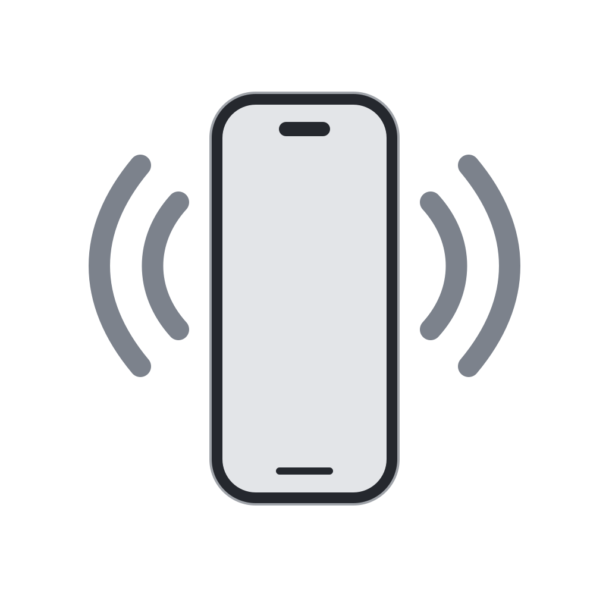

# PhonePing

Play a sound on your iPhone from the Mac menu bar. Click the icon, then choose **Play Sound** on your selected device.

PhonePing uses Apple's Find My app and the Apple Account already signed in on your Mac. It has no separate login, companion phone app, analytics, or developer server.

**Experimental source preview.** The current adapter has been tested with Find My in English on macOS 27.0.1, on Apple silicon. There is no signed public download yet. Find My's interface can change, so other macOS versions and languages are unverified. The macOS 14 build target is not a compatibility claim.

## Demo

<a href="https://github.com/user-attachments/assets/3f9dce7d-907a-40ac-aa4e-7434dc0e0fd3">
  
</a>

[Watch the 22-second demo](https://github.com/user-attachments/assets/3f9dce7d-907a-40ac-aa4e-7434dc0e0fd3). Animated preview with fictional device data.

## How it works

Choose a uniquely named device once in Settings. Later, use the menu bar to request a sound. Opening the menu does not ring anything.

If Find My is closed, PhonePing opens it without requesting activation. Its window may appear behind your work. Once Find My reports playback, PhonePing can close the temporary instance. A Find My instance that was already visible, or that you activate during the request, stays open. Pending or uncertain requests also leave it open.

The app verifies the exact name in the device list and again in its details before pressing Play Sound. Duplicate names, incomplete lists, and unfamiliar controls stop the request. It never chooses by location, clicks screen coordinates, or automatically retries a submitted sound.

## Build and set up

You need a Mac with Xcode or Command Line Tools providing Swift 5.9 or later. There are no third-party package dependencies.

```sh
bash scripts/build.sh
open dist/PhonePing.app
```

1. Make sure your iPhone appears in Find My on this Mac. Give it a unique name without commas or line breaks, and wait for Find My to show any rename.
2. In PhonePing, choose **Open System Settings…** and enable the app under **Privacy & Security → Device Control and Data Access** (called **Accessibility** on older macOS versions). Add `dist/PhonePing.app` with the + button if needed.
3. Choose **Find Devices**, select your iPhone, then test **Play Sound**.
4. Close Settings. Use the menu bar icon for subsequent requests.

Local builds are ad-hoc signed. Keep the app at a stable path and quit it before replacing it. Rebuilding may require removing and re-adding its permission. Do not disable macOS security protections. See [installation and release instructions](docs/DISTRIBUTION.md).

## Privacy

PhonePing stores your selected device name in local preferences. Names and status text encountered through Accessibility are processed in memory; the app does not save locations, screenshots, device history, or raw UI trees. **Clear Selection** removes the saved choice.

The app has no network client and does not read iCloud credentials, Keychain entries, tokens, browser sessions, or Find My caches. **Apple's Find My still uses the network to deliver the sound.** This is not an offline Bluetooth ping.

Accessibility permits broad control of other apps. PhonePing restricts its own code to Find My, but macOS does not grant a Find My-only permission. Read [Privacy](PRIVACY.md) for the exact boundaries, diagnostic behavior, and removal instructions.

## Status and limits

Build 12 has a verified cold-launch test: the iPhone rang, Find My stayed behind the current window, and its temporary process exited. Automated tests cover selection, device verification, single submission, uncertain results, and cleanup decisions. They do not establish real-device compatibility.

A controlled test with Find My already open also rang the phone, stayed behind the current app, and preserved the existing window. Find My came forward in an earlier test; that behavior was not reproduced and its exact cause is unproven. Long or virtualized lists, offline delivery, other window configurations, full keyboard/VoiceOver use, and repeated-use resource measurements still need testing. iPhone is the primary tested device; an Apple Watch test was reported during development. Other device types and Find My Items, including AirTags, are not claimed as supported.

An offline device may ring later. Silence an iPhone with a volume or power button. After an uncertain result, check Find My before requesting another sound. [Apple's Play Sound guide](https://support.apple.com/en-ca/guide/findmy-mac/fmm48b093e33/mac).

See [test evidence](docs/TESTING.md), [measured resource use](docs/PERFORMANCE.md), and the [release plan](docs/ROADMAP.md).

## Contributing

Compatibility fixes, accessibility checks, and reproducible bug reports are welcome. Use fictional device names; never post account details, precise locations, or raw Find My screenshots. Report security concerns through the process in [Security](SECURITY.md).

```sh
bash scripts/test.sh
python3 scripts/test-privacy.py
python3 scripts/check-privacy.py
bash scripts/build.sh
```

Read [Contributing](CONTRIBUTING.md) before your first commit. The [publishing checklist](docs/PUBLISHING.md) separates source publication from a signed download. GitHub checks do not ring devices or receive Apple credentials.

## License and credits

[MIT](LICENSE). An independent project by Lanza Studios Inc., maintained by [Spidersmanz](https://github.com/Spidersmanz).

PhonePing is a working name with [known naming overlap](docs/FINDMY-CLI-REVIEW.md#name). This project is not affiliated with Apple or other similarly named apps. Apple, iPhone, macOS, and Find My are Apple trademarks.
